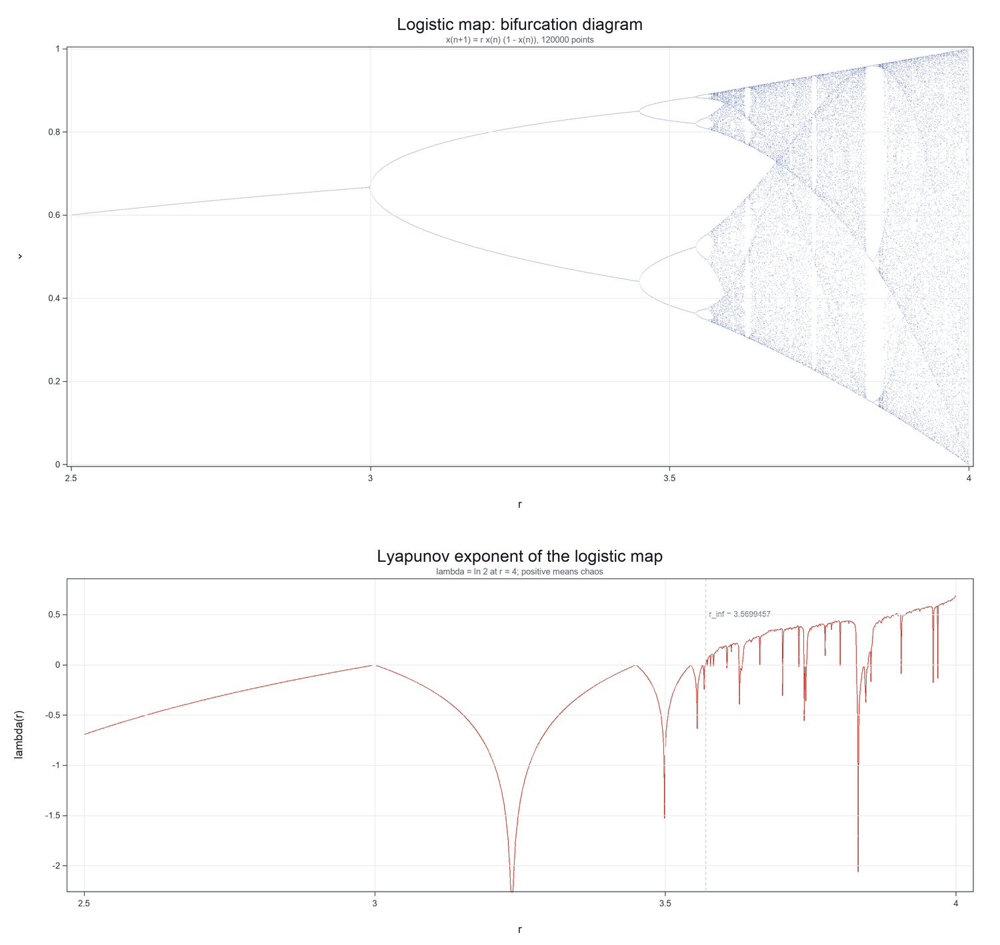
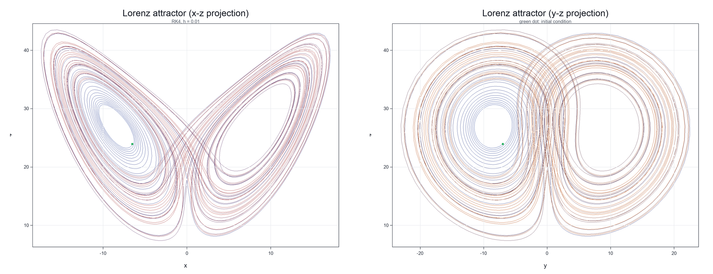
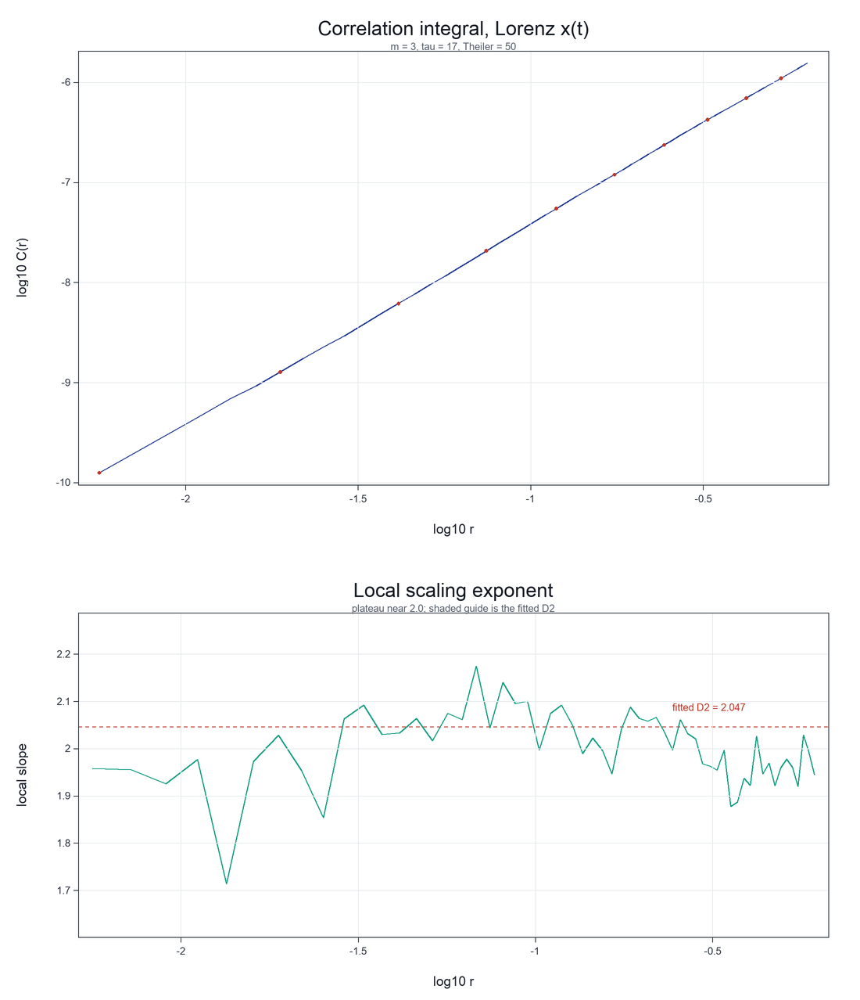
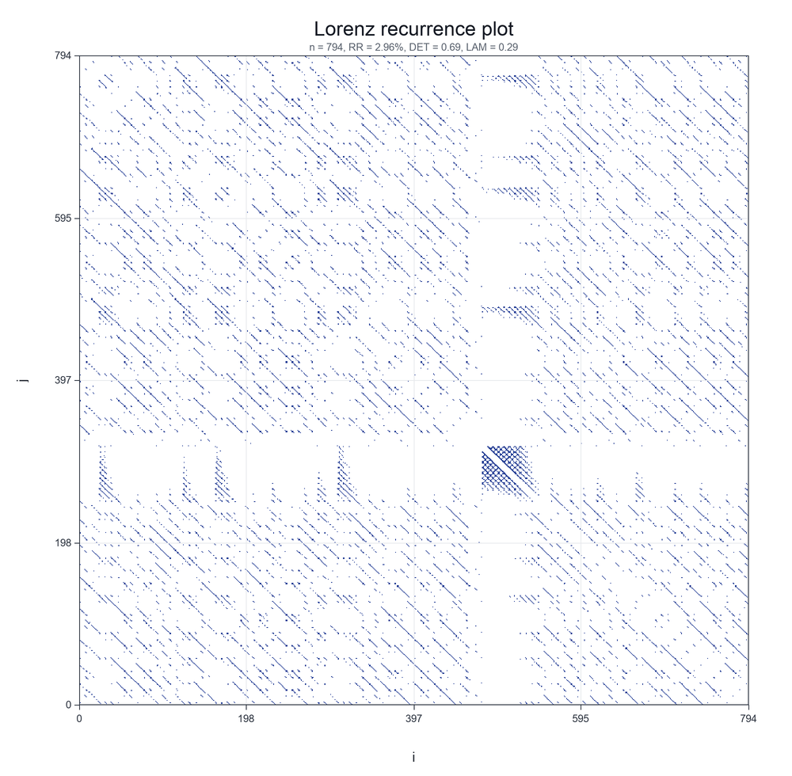

# chaos-lab

这是我自己整理的一个 C++17 混沌系统实验库。最初只想验证两件事：Logistic 映射在 $r=4$ 时 Lyapunov 指数是不是 $\ln 2$，以及 Lorenz 吸引子的维数是不是真的在 2.06 附近。单位、瞬态该丢多少、拟合区间怎么选，以及“看起来像混沌”和“真的混沌”之间隔着多少检验。

所以这个仓库除了代码，还留下了数据、生成脚本、测试和一组带文献编号的文档。数值结论尽量能追到具体命令；追不到的，会标成“实测”，不冒充文献值。

## 里面有什么

- 模型：Logistic、Hénon、Arnold 猫映射、Lorenz、Rössler、Chua、双摆、平面三体（8 字编舞）。
- 积分：RK4、Dormand–Prince 5(4)、velocity Verlet、Yoshida 四阶辛积分。
- Lyapunov：Benettin/QR 全谱、双轨迹最大指数、Rosenstein 时间序列方法。
- 相空间：延迟嵌入、AMI、自相关、FNN、Grassberger–Procaccia 关联维。
- 诊断：分岔扫描、Poincaré 截面、功率谱、RQA、0-1 检验、傅里叶替代数据。
- 控制与建模：OGY、Pyragas（映射版）、Pecora–Carroll 同步、SINDy/STLSQ。
- 另外还有 C API、一个命令行工具、33 个测试、19 个 CSV 和 21 张图。

代码是 C++17，没有第三方运行时依赖；C 接口在 `include/chaos/chaos_c.h`。

## 跑起来

```bash
git clone https://github.com/cxy2696/chaos-lab.git
cd chaos-lab

cmake -S . -B build -DCMAKE_BUILD_TYPE=Release
cmake --build build -j
ctest --test-dir build --output-on-failure

./build/chaos_cli models
./build/chaos_cli lyapunov --system lorenz --h 0.01 --transient 50 --duration 500
```

最后一条会打印：

```
system lorenz exponents: 0.910064 -0.004271 -14.572357  sum=-13.666564
```

和文献里的 $(0.906, 0, -14.57)$ 有一点差，原因在文档里写了，不是“调参调出来”的。

在自己的 C++ 项目里用：

```cpp
#include <cstdio>
#include "chaos/integrators.hpp"
#include "chaos/lyapunov.hpp"
#include "chaos/systems.hpp"

int main() {
    chaos::Lorenz lorenz;
    chaos::OdeSystem sys = lorenz.ode();

    chaos::LyapunovOptions opt;
    opt.h = 0.01;
    opt.transient = 50.0;
    opt.duration = 500.0;
    auto spectrum = chaos::lyapunov_spectrum(sys, {1, 1, 1}, opt);
    for (double v : spectrum.exponents) std::printf("% .4f ", v);
    std::printf("\n");
}
```

```bash
c++ -std=c++17 -O2 -Iinclude your.cpp build/libchaos.a -o your
```

CMake 工程里可以 `add_subdirectory`，也可以安装后 `find_package(chaos CONFIG REQUIRED)`，链接 `chaos::chaos`。我本地装了一遍，用一个小工程验证过能编过。

C 的用法：

```c
#include "chaos/chaos_c.h"

double exponents[3];
const double x0[3] = {1, 1, 1};
if (chaos_lorenz_lyapunov(10, 28, 8.0/3, x0, 0.01, 50, 500, exponents) == 0) {
    printf("%f %f %f\n", exponents[0], exponents[1], exponents[2]);
}
```

注意链接时用 C++ 链接器，库内部还是 C++。

## 我实际测到的数

下面这些值都是本地机器上用当前代码跑出来的，不是从书上抄的。参数和命令在 `docs/data-provenance.md`。

| 量 | 参考值 | 这次测得 |
|---|---|---|
| Logistic $\lambda(4)$ | $\ln 2=0.693147$ | 0.693149 |
| Feigenbaum $\delta$ | 4.669201609 | 4.669157 |
| Lorenz $\lambda$ 谱 | $(0.906, 0, -14.57)$ | $(0.9101,-0.0043,-14.5724)$ |
| Lorenz $D_2$ | 约 2.06 | 2.047 |
| Hénon $\lambda$ 谱 | $(0.419,-1.623)$ | $(0.4206,-1.6246)$ |
| 三体 8 字一个周期 | $T=6.32591398$ | 回到初值差 $2.0\times10^{-4}$ |
| 0-1 检验 Lorenz（降采样后） | $K\approx1$ | 0.9905 |
| Pecora–Carroll 同步 | 误差指数收敛 | $t\approx7.6$ 后小于 $10^{-6}$ |

有两个地方值得先说明：

- Rosenstein 从 $x(t)$ 估出来是 0.855，Benettin 是 0.910，差了约 6%。这不是哪个“更对”，而是有限数据、拟合区间和嵌入参数共同造成的。
- 0-1 检验我一开始直接用 $dt=0.01$ 的 8000 个点，得到 $K\approx-0.274$，差点以为 Lorenz 是周期的。每隔 10 个点降采样之后才回到 0.9905。过采样会把扩散项盖住，这个坑写在 `docs/chaos-systems.md` 的 5.5 节。

## 三个可以照着做的实验

**Logistic 分岔和 Lyapunov 指数**

```bash
./build/chaos_cli bifurcation --map logistic --pmin 2.5 --pmax 4 \
  --nparams 1500 --transient 1000 --keep 80 --out data/logistic_bifurcation.csv

./build/chaos_cli lyapunov-scan --map logistic --nparams 1500 --n 20000 \
  --out data/logistic_lyapunov.csv
```

看 $\lambda$ 在哪里由负变正、$r=4$ 是否接近 0.693、周期 3 窗口里 $\lambda$ 是否又变负。

**Lorenz 谱**

```bash
./build/chaos_cli lyapunov --system lorenz --h 0.01 --transient 50 --duration 500
```

检查三个指数符号，以及它们的和是不是接近 $-\left(\sigma+1+\beta\right)$。

**从一维 $x(t)$ 重构**

```bash
./build/chaos_cli ami --input data/lorenz_series.csv --column 1 --max-tau 60
./build/chaos_cli fnn --input data/lorenz_series.csv --column 1 --tau 17 --max-m 8
./build/chaos_cli dimension --input data/lorenz_series.csv --column 1 \
  --m 3 --tau 17 --theiler 50 --out data/lorenz_gp.csv
./build/chaos_cli rosenstein --input data/lorenz_series.csv --column 1 \
  --m 3 --tau 17 --theiler 100 --max-k 300 --dt 0.01
```

我这边得到的 $\tau=17$、$m=3$、$D_2=2.047$、$\lambda_{\max}=0.855$。你跑出来如果有小差别，先看步长和拟合区间，不一定是代码错了。

## 图

Logistic 分岔图：



Lorenz 吸引子：



从 $x(t)$ 估关联维：



递归图：



其余在 `docs/figures/`。

## 仓库结构

```text
chaos-lab/
├── include/chaos/          头文件（C++17 + C API）
├── src/                    实现
├── apps/chaos_cli.cpp      命令行
├── tests/                  33 个数值测试 + C API smoke test
├── docs/
│   ├── chaos-systems.md    理论主线，带 [1]–[50] 引用
│   ├── algorithms.md       函数签名、单位、复杂度
│   ├── experiments.md      实验手册
│   ├── references.md       文献列表，DOI 已核
│   ├── data-provenance.md  数据/断言/命令/校验和
│   ├── rigor.md            可证性、假设与数值边界
│   └── figures/            21 张图
├── data/                   19 个 CSV、metrics.json、checksums
├── references/references.bib
├── scripts/                生成数据、画图、Feigenbaum、元数据
├── CMakeLists.txt
└── .github/workflows/ci.yml
```

## 文档怎么读

如果只想看“混沌到底是什么”，从 `docs/chaos-systems.md` 开始；它按“概念—模型—路径—算法—控制—应用”的顺序展开，把公式、数值陷阱和代码位置补上了。想改代码或查函数，看 `docs/algorithms.md`；想动手，看 `docs/experiments.md`。所有文献编号在 `docs/references.md`，数据是怎么来的在 `docs/data-provenance.md`；哪些结论是定理、哪些只是数值估计，单独写在 `docs/rigor.md`。

## 已知不足

- GP、FNN、Rosenstein 都是 $O(N^2)$，没有 KD-tree。几万点还能等，再大就不合适了。
- 替代数据只实现了傅里叶相位随机化，没有 AAFT/IAAFT。
- Pyragas 只有离散映射版，ODE 的延迟反馈没做。
- 储备池计算（RC）和 DMD 只写在文档里，代码没实现。
- 没有刚性求解器、并行和 GPU。这个库的定位是学习和做小实验，不是生产数值软件。
- 三体只做了平面等质量；高精度星历、摄动、碰撞检测都没有。

## 数据和复现

```bash
./scripts/generate_data.sh
python3 scripts/make_metadata.py
shasum -a 256 -c data/checksums.sha256     # macOS
# Linux 用 sha256sum -c data/checksums.sha256

python3 scripts/plot_figures.py            # 需要 Pillow
```

数据全部由 `chaos_cli` 生成。改了参数就重新生成，并同步更新 `docs/data-provenance.md` 和校验和。

## 最后
文献条目在 `references/references.bib`。

> 另外提醒一句：仓库里的 Logistic/猫映射代码不要拿去做真实加密。有限精度会让序列退化，已经有很多“混沌图像加密”方案被攻破，`docs/chaos-systems.md` 的 7.7 节引了例子。
