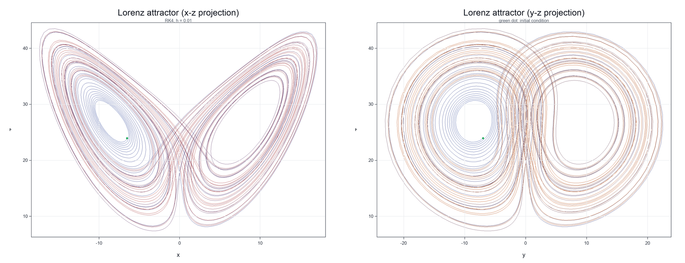
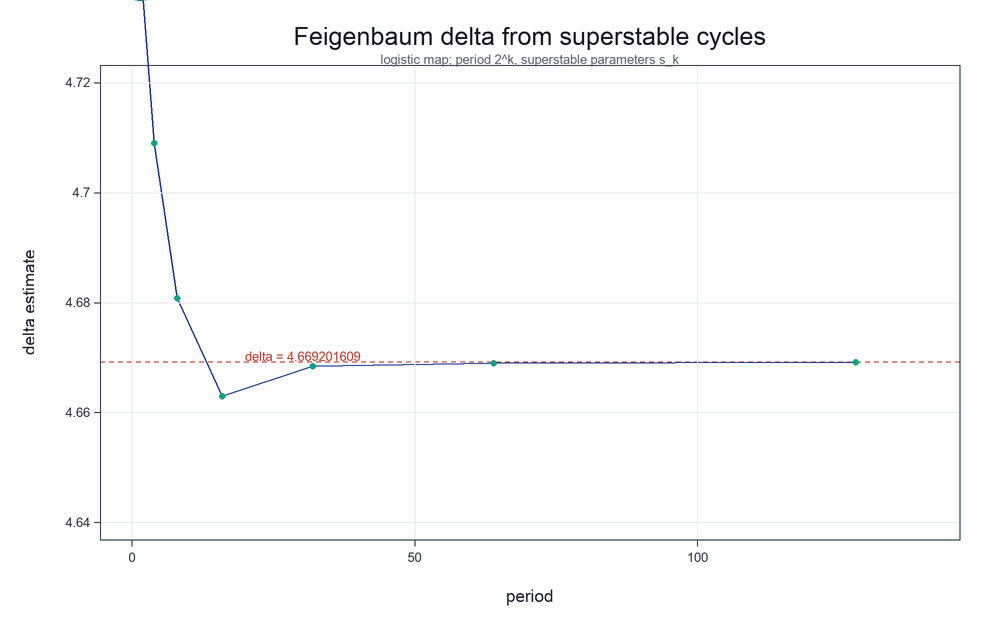
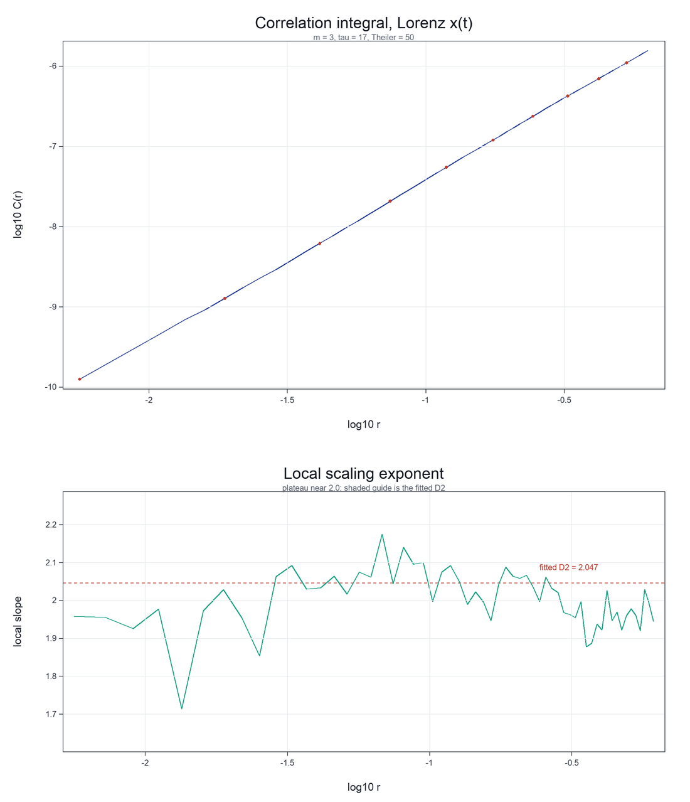
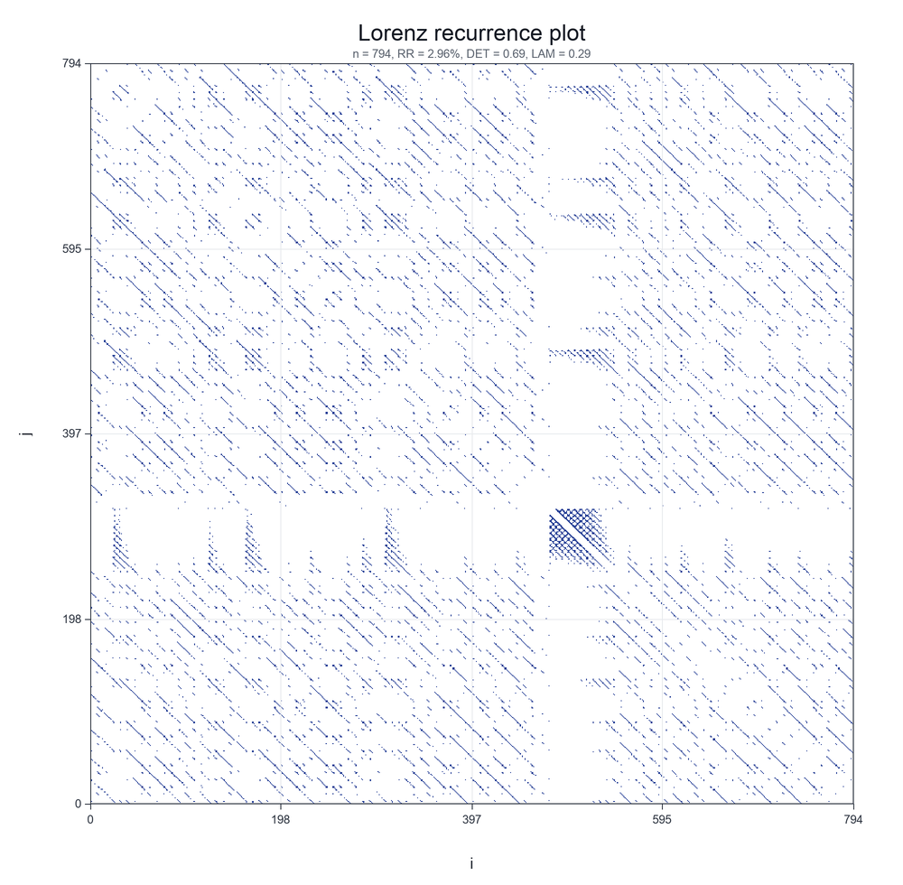

# 混沌系统：从理论到 C/C++ 实现

> 这篇笔记把定义、经典模型、通往混沌的路径、分析算法、控制/同步/预测和应用串起来，并尽量把公式、数值陷阱与可复现实验写清楚。  
> `[n]` 对应 [`docs/references.md`](references.md)；仓库内测得的数值、数据文件和复现命令见 [`docs/data-provenance.md`](data-provenance.md)；哪些是定理、哪些只是数值估计，见 [`docs/rigor.md`](rigor.md)。  
> 代码入口：[`include/chaos/`](../include/chaos/)；实验命令：[`docs/experiments.md`](experiments.md)。

---

## 0. 阅读地图

| 你想解决的问题 | 先读 | 再用 |
|---|---|---|
| 判断一个系统是不是混沌 | §1、§5.1、§5.5 | `lyapunov_spectrum`、`zero_one_test` |
| 只有一维观测数据 | §5.2 | `delay_embed`、`average_mutual_information`、`false_nearest_neighbors` |
| 估计分形维数 | §1.4、§5.2 | `correlation_dimension` |
| 画分岔图 / Poincaré 截面 | §5.3 | `bifurcation_scan_1d`、`poincare_section` |
| 做控制 / 同步 | §6 | `ogy_control_1d`、`pyragas_map_control`、`pecora_carroll_lorenz` |
| 从数据拟合方程 | §6.4 | `sindy_fit` |
| 做金融/生理/声学数据 | §8 | RQA、0-1、替代数据；先读 §8.2 的警告 |

---

## 1. 什么是混沌

### 1.1 定义与三个判据

**混沌（chaos）** 指确定性非线性系统的长期行为同时满足：

1. **有界性**：轨迹不逃逸到无穷，被限制在相空间某个有界区域内；
2. **非周期性**：轨迹不精确重复（不是不动点、周期轨道或准周期环面）；
3. **初值敏感性**：相邻初值的距离随时间近似指数分离，最大 Lyapunov 指数 $\lambda_{\max}>0$。

第三条是“混沌”与“复杂但可预测”的分水岭。一个系统可以非线性、可以有很多周期，但只要 $\lambda_{\max}\le 0$，就不是通常意义下的混沌。

> **常见误解**
> - 混沌不是“随机”：方程没有随机项；不确定性来自初值和模型误差的放大。
> - 混沌不是“不稳定”：耗散混沌系统被吸引到有界吸引子上，轨迹不会发散。
> - 混沌不是“不可计算”：短期数值解仍可算；不可预测的是长期细节，而不是统计性质。

### 1.2 Lyapunov 指数：定义与可预测时间

设两条初值相距 $\delta_0$ 的轨迹，$t$ 时刻距离为 $\delta(t)$。一维情形

$$
\delta(t)\approx \delta_0 e^{\lambda t},
\qquad
\lambda=\lim_{t\to\infty}\lim_{\delta_0\to0}\frac1t\ln\frac{\delta(t)}{\delta_0}.
$$

$\lambda>0$ 表示指数分离；**Lyapunov 时间** $\tau_L=1/\lambda$ 是可预测时间尺度。Lorenz 系统 $\lambda_{\max}\approx0.906$，所以 $\tau_L\approx1.1$ 个时间单位；$t=10$ 时，初始误差已被放大 $e^{9}\approx 8000$ 倍。

$n$ 维系统有 $n$ 个 Lyapunov 指数 $\lambda_1\ge\lambda_2\ge\cdots\ge\lambda_n$：

- 连续自治流总有一个零指数（沿轨道方向）；
- 耗散系统 $\sum_i\lambda_i<0$；
- 若 $\lambda_1>0$ 且系统有界，则通常出现奇怪吸引子。

### 1.3 奇怪吸引子与分形维数

**吸引子**是相空间中轨迹长期趋向的集合。**奇怪吸引子**通常具有非整数维数和自相似/Cantor 状结构，但“奇怪”并没有统一的维数定义；非整数维数是一个常见特征，不是定义本身。常见维数：

- **容量维** $D_0$：覆盖所需盒子数 $N(\epsilon)\sim\epsilon^{-D_0}$；
- **关联维** $D_2$：由关联积分 $C(r)\sim r^{D_2}$ 估计 [24]；
- **Kaplan–Yorke 维数** [29]：

$$
D_{KY}=j+\frac{\sum_{i=1}^{j}\lambda_i}{|\lambda_{j+1}|},
\quad
j=\max\{k:\sum_{i=1}^{k}\lambda_i\ge0\}.
$$

Lorenz 系统经典参数下 $\lambda\approx(0.906,0,-14.57)$，故

$$
D_{KY}=2+\frac{0.906}{14.57}\approx2.062.
$$

这里的 $D_{KY}$ 是 Lyapunov 谱定义的维数；Kaplan–Yorke 猜想在适当条件下把它与信息维联系起来，但不能把 $D_{KY}$ 和关联维 $D_2$ 当成同一个量。文献常引用“约 2.06”，本仓库从标量 $x(t)$ 用 GP 算法测得 $D_2=2.047$，两者接近但不是同一个估计（见 §5.2 与图）。



### 1.4 维数下限：为什么连续自治系统至少要三维

- **连续自治 ODE**：Poincaré–Bendixson 定理说明，平面自治系统的有界轨迹在奇点有限等标准条件下，极限集只能是不动点或闭轨，不能是奇怪吸引子；因此至少需要 **三维**（Lorenz、Rössler、Chua 都是三维）。
- **离散映射**：一维即可混沌。Logistic 映射在 $r=4$ 时 $\lambda=\ln2>0$。
- **非自治/时滞系统**：可把时间或延迟看成额外维度，因此二维非自治方程或一维时滞方程也能混沌。

这条“维数下限”是判断模型是否可能混沌的第一道筛选，但它只是必要条件，不是充分条件。

### 1.5 不稳定周期轨道与影子引理

**不稳定周期轨道（UPO）**：在 Axiom A/双曲吸引子上，UPO 在吸引子中稠密；对一般混沌吸引子，通常也能找到大量 UPO，但“无穷多条”不是仅由 $\lambda_1>0$ 推出的定理。它们像“骨架”一样组织轨迹，是 OGY 控制的基础 [31]。

**影子引理（shadowing lemma）**：对双曲系统，数值轨道（受舍入误差影响）附近存在一条真实轨道，在有限时间内与数值轨道保持接近 [48]。它说明“数值轨道不必逐点等于某条真实轨道，但仍可能被一条真实轨道跟踪”。

但这不等于“任意统计量自动可信”。统计估计还需要遍历性、绝对连续性、误差控制和收敛测试；双曲性、时间长度、误差界都是前提。做定量结论时，步长/精度收敛测试不能省。

---

## 2. 经典模型

### 2.1 Logistic 映射（一维离散）

$$
x_{n+1}=r\,x_n(1-x_n),\qquad x\in[0,1],\ r\in[0,4].
$$

| 参数范围 | 行为 |
|---|---|
| $0<r<1$ | 趋向 $x=0$ |
| $1<r<3$ | 稳定不动点 $x^*=1-1/r$ |
| $r=3$ | 倍周期分岔开始 |
| $3<r<3.5699456$ | 倍周期级联 $2\to4\to8\to\cdots$；窗口内为周期轨道，窗口之间可出现混沌带 |
| $r\approx3.569945672$ | 倍周期累积点 $r_\infty$，之后是混沌带与周期窗口交错 |
| $r\approx3.8284$ | 周期 3 窗口（“周期三意味着混沌” [5]） |
| $r=4$ | 典型初值下混沌，$\lambda=\ln2$（a.e.） |

**Lyapunov 指数**（解析）：

$$
\lambda(r)=\lim_{N\to\infty}\frac1N\sum_{n=0}^{N-1}
\ln\left|r(1-2x_n)\right|.
$$

在 $r=4$ 时可通过共轭 $x=\sin^2(\pi\theta/2)$ 证明：对 Lebesgue 几乎所有的初值，$\lambda=\ln2$。$x=0$、$x=0.5$ 等特殊轨道最终落到 0，不属于这个结论。本仓库数值结果 $0.693149$，与 $\ln2=0.693147$ 相差约 $2\times10^{-6}$（$10^6$ 次迭代）。

**Feigenbaum 常数**：

$$
\delta=\lim_{n\to\infty}\frac{r_{n}-r_{n-1}}{r_{n+1}-r_n}\approx4.669201609,
\qquad
\alpha\approx2.502907875.
$$

属于同一二次单峰普适类、满足 Feigenbaum 重整化假设的映射，具有同一对常数 [7,8]。这不是“所有单峰映射”都成立：三次极大、不同临界指数的映射属于别的普适类。本仓库用超稳定周期 $f^{2^k}(1/2)=1/2$ 的参数序列估计，最后一个 $\delta$ 估计为 $4.669157$（误差 $<10^{-5}$），见 [`data/feigenbaum.csv`](../data/feigenbaum.csv) 与 `scripts/feigenbaum.py`。



### 2.2 Lorenz 系统（三维连续）

$$
\dot x=\sigma(y-x),\qquad
\dot y=x(\rho-z)-y,\qquad
\dot z=xy-\beta z.
$$

经典参数 $\sigma=10,\ \rho=28,\ \beta=8/3$。

- 散度 $\nabla\cdot f=-(\sigma+1+\beta)=-13.6667$，相空间体积指数收缩；
- 文献 Lyapunov 谱约 $(0.906,0,-14.57)$ [9,17]；
- 本仓库 $h=0.01$、$T=500$ 测得 $(0.9101,-0.0043,-14.5724)$，和 $=-13.6666$；
- 吸引子维数约 $2.06$，本仓库 GP 测得 $2.047$；
- 来源：Lorenz 1963 年对大气对流的 Saltzman 方程截断 [2]；“蝴蝶效应”的起点。

**为什么是三维？** 二维自治流被 Poincaré–Bendixson 排除；Lorenz 的两个非线性项 $xz$、$xy$ 提供折叠与拉伸，使轨迹在两个“翅膀”之间切换。

### 2.3 Hénon 映射（二维离散）

$$
x_{n+1}=1-a x_n^2+y_n,\qquad y_{n+1}=b x_n,
\qquad a=1.4,\ b=0.3.
$$

Jacobian

$$
J(x,y)=\begin{pmatrix}-2ax & 1\\ b & 0\end{pmatrix}.
$$

- 文献谱约 $(0.419,-1.623)$，和 $\ln|b|=\ln0.3=-1.204$；
- 本仓库测得 $(0.4206,-1.6246)$，和 $-1.2040$；
- 关联维约 $1.21$；本仓库自动尺度给出 $1.16$，手动选择尺度区可到 $1.21$（有限样本效应，见 §5.2）。

### 2.4 Rössler 系统（三维连续）

$$
\dot x=-y-z,\qquad
\dot y=x+ay,\qquad
\dot z=b+z(x-c).
$$

经典 $a=b=0.2,\ c=5.7$。结构比 Lorenz 简单：一个近乎平面的螺旋 + 一个返回折叠。常见报告的最大指数约 $0.07$；本仓库 $h=0.01,T=500$ 测得 $0.0790$。具体数值会随参数、瞬态和算法变化，不要把 $0.071$ 当成唯一真值。

### 2.5 Chua 电路（三维分段线性）

$$
\dot x=\alpha\bigl(y-x-f(x)\bigr),\quad
\dot y=x-y+z,\quad
\dot z=-\beta y,
$$

其中

$$
f(x)=m_1x+\frac{m_0-m_1}{2}\bigl(|x+1|-|x-1|\bigr).
$$

经典 $\alpha=15.6,\ \beta=28,\ m_0=-1.143,\ m_1=-0.714$。$f$ 是分段线性，吸引子为“双涡卷（double scroll）” [13]。本仓库测得谱 $(0.4247,-0.0071,-4.2179)$，和 $-3.8003$。

分段线性系统的 Jacobian 在 $|x|=1$ 处不连续；数值积分时步长应避免正好跨过折点，或使用事件检测。

### 2.6 双摆、三体与哈密顿系统

**双摆**（状态 $[\theta_1,\theta_2,\omega_1,\omega_2]$）是哈密顿系统，能量守恒。其运动方程含耦合非线性项，初始条件的微小差异会指数放大；它是最直观的“桌面混沌”实验。

**平面三体**（状态 12 维）在等质量、$G=1$ 时有 Chenciner–Montgomery **8 字形编舞** [14]：

- 初值：$r_1=(-0.97000436,0.24308753)$，$r_2=-r_1$，$r_3=0$；
- 速度：$v_1=v_2=(0.4662036850,0.4323657300)$，$v_3=(-0.93240737,-0.86473146)$；
- 周期 $T\approx6.32591398$。

本仓库用 RK4 $h=0.002$ 积分一个周期，回到初值的距离约 $2\times10^{-4}$，能量漂移 $<10^{-12}$（测试 `three_body_figure_eight_periodic`）。三体是哈密顿系统，长期积分应优先用辛积分器（§4）。

### 2.7 Arnold 猫映射（环面线性映射）

$$
\begin{pmatrix}x_{n+1}\\y_{n+1}\end{pmatrix}
=
\begin{pmatrix}1&1\\1&2\end{pmatrix}
\begin{pmatrix}x_n\\y_n\end{pmatrix}
\bmod 1.
$$

Jacobian 常数，特征值 $(3\pm\sqrt5)/2$，故

$$
\lambda_1=\ln\frac{3+\sqrt5}{2}\approx0.9624,\qquad
\lambda_2=-\lambda_1.
$$

它是保面积映射（$\sum\lambda_i=0$），常被用于图像置乱 [15]。注意：**置乱 ≠ 安全加密**，见 §7.7。

### 2.8 模型对照表

| 模型 | 类型 | 维数 | 经典参数 | 已知不变量/特征 | 代码 |
|---|---|---|---|---|---|
| Logistic | 离散 | 1 | $r=4$ | $\lambda=\ln2$ | `Logistic` |
| Hénon | 离散 | 2 | $a=1.4,b=0.3$ | $\lambda_1\approx0.419$, $\sum=\ln b$ | `Henon` |
| 猫映射 | 离散 | 2 | — | $\lambda_1=\ln((3+\sqrt5)/2)$ | `CatMap` |
| Lorenz | ODE | 3 | $10,28,8/3$ | $\sum\lambda=-13.667$ | `Lorenz` |
| Rössler | ODE | 3 | $0.2,0.2,5.7$ | 漏斗吸引子 | `Rossler` |
| Chua | ODE | 3 | $15.6,28,-1.143,-0.714$ | 双涡卷 | `Chua` |
| 双摆 | ODE | 4 | $m=l=1,g=9.81$ | 能量守恒 | `DoublePendulum` |
| 三体 | ODE | 12 | 等质量 $G=1$ | 能量、动量守恒 | `ThreeBody` |

---

## 3. 通往混沌的路径

### 3.1 倍周期分岔（Feigenbaum 路径）

周期 $1\to2\to4\to8\to\cdots$，参数间隔按 $\delta$ 收缩，最终在 $r_\infty$ 进入混沌。机制是**拉伸 + 折叠**的单峰映射迭代；普适性来自重整化群：把两次迭代看作一次新映射，尺度变换后回到同一函数族 [7,8,50]。

与渗流的类比见 §3.4。

### 3.2 准周期路径（Ruelle–Takens–Newhouse）

不动点 → 极限环（1 个频率）→ 二维环面（2 个不可通约频率）→ 环面破裂 → 奇怪吸引子 [4]。Newhouse–Ruelle–Takens 进一步说明：在 $T^m$（$m\ge3$）附近，微小扰动可产生 Axiom A 奇怪吸引子 [47]。

这条路径在流体实验（Couette–Taylor、Rayleigh–Bénard）中很常见；识别标志是功率谱中出现新的不可通约频率，随后谱线展宽。

### 3.3 阵发性（Pomeau–Manneville）

参数略过临界值时，系统在很长时间内表现为近似周期的“层流”，其间夹杂短暂的混沌爆发；越靠近临界点，爆发越稀少。用返回时间/层流长度分布可以识别 [49]。这与“危机（crisis）”不同：阵发性的层流段有特征标度。

### 3.4 普适性、重整化群与渗流

| 系统 | 临界点 | 普适常数/指数 | 机制 |
|---|---|---|---|
| 单峰映射倍周期 | $r_\infty\approx3.5699457$ | $\delta\approx4.6692,\ \alpha\approx2.5029$ | 函数复合的重整化 |
| 渗流 | $p_c$（依晶格） | $\beta,\gamma,\nu$ 等（依维数） | 尺度变换/重整化 |
| 连续相变 | $T_c$ | 临界指数 | Wilson 重整化群 [50] |

**可以连起来的地方**：两者都用“粗粒化 + 尺度变换”解释为什么微观细节不重要；临界指数/Feigenbaum 常数只依赖维数、对称性等少数特征。

**不能混为一谈的地方**：Feigenbaum 是**一维映射复合**的普适性，渗流是**几何连通性**的临界现象；两者的重整化变换不同，临界指数也没有一一对应关系。把它们作为“同一类思想”对照是合理的，把 $\delta$ 当成渗流指数则是错误的。

---

## 4. 数值积分

### 4.1 方法选择

| 方法 | 阶数 | 适用 | 优点 | 风险 |
|---|---|---|---|---|
| RK4 | 4 | 一般耗散 ODE | 简单、稳定、易实现 | 定步长；长期能量漂移 |
| Dormand–Prince 5(4) | 5(4) 自适应 | 需要精度控制 | 误差估计、自动步长 | 刚性系统效率低 |
| Verlet（velocity） | 2 | 哈密顿/二阶系统 | 辛、长期能量有界 | 只有二阶精度 |
| Yoshida 4 | 4 | 哈密顿/二阶系统 | 辛 + 四阶 | 每步 3 次力计算 |

**不要**用 RK4 长期积分三体/双摆并宣称能量守恒；应使用 Verlet/Yoshida，或至少做步长收敛测试。RK4 的截断误差会缓慢改变能量，混沌系统还会放大相位误差。

### 4.2 代码接口

```cpp
#include "chaos/integrators.hpp"
using namespace chaos;

Lorenz lorenz;
OdeSystem sys = lorenz.ode();

State x{1, 1, 1};
const double h = 0.01;
for (int i = 0; i < 10000; ++i) x = rk4_step(sys, x, i * h, h);

// 自适应：t=0..10，初试步长 0.01，rtol/atol
Rk45Result r = rk45_integrate(sys, {1,1,1}, 0.0, 10.0, 0.01,
                              Rk45Options{1e-9, 1e-11});
```

辛积分器用于二阶系统 $q''=a(q)$：

```cpp
auto accel = [](const State& q) { return State{-q[0], -q[1]}; };
State q{1,0}, v{0,1};
for (int i = 0; i < 10000; ++i) yoshida4_step(accel, q, v, 0.01);
```

### 4.3 步长、误差与“影子”

- 先用两个步长（如 $h$ 与 $h/2$）比较轨迹的统计量，而不是逐点比较；
- Lyapunov 指数对 $h$ 的敏感性通常低于轨迹本身，但仍需收敛测试；
- 对分段线性系统（Chua），事件检测比盲目减小步长更可靠；
- 自适应积分器在混沌系统中会因误差放大而不断缩步；长期统计量建议固定步长 + 辛方法，或定期重正交化。

---

## 5. 分析算法

### 5.1 Lyapunov 谱：Benettin 与双轨迹法

**Benettin 算法** [16]：

1. 沿主轨迹 $x(t)$ 积分；
2. 同时积分切向量 $Q$（$d\times k$）：$\dot Q=J(x(t))Q$；
3. 每隔若干步对 $Q$ 做 QR 分解/修正 Gram–Schmidt；
4. 把 $\ln|R_{ii}|$ 累加，除以总时间；
5. 得到前 $k$ 个指数。

若没有解析 Jacobian，库自动用中心差分。`LyapunovOptions` 控制 `h`、`transient`、`duration`、`reorthonormalize_every`。

**双轨迹法**（只求 $\lambda_{\max}$）：同时演化相距 $d_0$ 的两条轨迹，每步把距离拉回 $d_0$，累加 $\ln(d/d_0)$。实现见 `lyapunov_max_two_trajectories`。它简单但只给最大指数，且对 $d_0$ 敏感。

**从数据估计**：

- **Wolf 算法** [17]：在重构相空间中跟踪最近邻的演化；
- **Rosenstein 算法** [19]：对每个点找最近邻，计算平均 $\ln d_i(k)$ 的斜率；
- **Sano–Sawada** [18]：局部 Jacobian 方法。

**单位陷阱**：Rosenstein 的离散斜率是“每个采样步”的指数，应除以采样间隔 $\Delta t$，**不是**除以 $\tau\Delta t$。本仓库实现已在 `rosenstein_lyapunov` 中固定这一点，并提供 `fit_begin/fit_end` 选择线性区。

**实测**（Lorenz $x(t)$，$m=3,\tau=17$，Theiler=100，$\Delta t=0.01$）：$\lambda=0.855$（相对 Benettin 的 0.910 低约 6%）；Hénon 用 $m=2,\tau=1$、拟合 $k=0..10$ 得 $0.419$。有限数据、拟合区间和噪声都会影响结果。

### 5.2 相空间重构：Takens、AMI、FNN、GP

**Takens 嵌入** [20,21]：设吸引子位于一个紧致 $d$ 维光滑流形上，用延迟坐标

$$
\mathbf X_n=\bigl(x_n,x_{n-\tau},\ldots,x_{n-(m-1)\tau}\bigr)
$$

重构吸引子；泛型条件下 $m\ge2d+1$ 时，重构与原吸引子微分同胚。对分形吸引子，$d$ 不能直接当成关联维；Sauer–Yorke–Casdagli 的 Embedology 讨论了更一般的情形。实践中 $m$ 常取 3–10，$\tau$ 取 AMI 第一极小或自相关首次过零/降到 $1/e$，这些都是选参启发式，不是定理。

**延迟 $\tau$**：

- **平均互信息（AMI）** [22]：$\tau$ 取 AMI 的第一个局部极小；过小则坐标冗余，过大则坐标不相关。
- **自相关**：取首次过零或降到 $1/e$ 的滞后。简单但只捕捉线性相关。

**嵌入维 $m$**：

- **假近邻法（FNN）** [23]：在 $m$ 维找最近邻，检查第 $m+1$ 个坐标是否使距离暴涨；假近邻比例降到约 0 时的 $m$ 可用。
- **Cao 方法**：FNN 的改进，对噪声更稳健（本库未实现）。

**关联维（Grassberger–Procaccia）** [24]：

$$
C(r)=\frac{2}{N(N-1)}\sum_{i<j}\Theta\bigl(r-\|\mathbf X_i-\mathbf X_j\|\bigr)
\sim r^{D_2}.
$$

在 $\log C$–$\log r$ 的标度区拟合斜率。**关键**：标度区必须手动检查；把所有半径都拿来拟合会得到偏低的值（大 $r$ 处饱和）。本库返回局部斜率与拟合区间，默认用分位数选一个保守范围。

**实测**：

- Lorenz $x(t)$，$m=3,\tau=17$，Theiler=50：$D_2=2.047$，$R^2=0.9999$，$r\in[0.105,0.821]$；
- Hénon，$m=2,\tau=1$：自动范围 $D_2=1.156$；手动选 $r\in[0.0005,0.5]$、拟合中段可到 $1.21$。



### 5.3 庞加莱截面、分岔图、功率谱

- **庞加莱截面**：把连续流降到离散映射。对 Lorenz 取 $z=\rho-1=27$ 的下穿点，得到 240 个点（$t=20..200$）。截面上的结构能揭示折叠与旋转数。
- **分岔图**：固定初值，扫参数，丢弃瞬态，画后期迭代值。Logistic 的图见 `docs/figures/logistic.png`；周期窗口、倍周期树和混沌带一目了然。
- **功率谱**：周期/准周期信号是离散谱线；混沌通常表现为宽带连续谱。注意窗函数、零填充和采样率会改变外观；不要只凭“谱很宽”就判定混沌。

### 5.4 递归图与 RQA

**递归图** [25]：$R_{ij}=1$ 若 $\|\mathbf X_i-\mathbf X_j\|\le\epsilon$。它把轨迹的“回访”可视化；在非平稳、短数据上常被使用，但解释要谨慎，最好配合分段和替代数据。

**RQA 指标** [26]：

| 指标 | 含义 |
|---|---|
| RR | 递归率：非对角递归点占非对角点对的比例 |
| DET | 确定度：属于长度 ≥ `min_line` 的对角线的递归点比例 |
| LAM | 层流度：属于垂直线的递归点比例 |
| ENTR | 对角线长度分布的 Shannon 熵 |
| TT | 平均垂直/停留时间 |
| Lmax | 最长对角线 |

本库 `rqa` 返回上述指标；阈值 $\epsilon$ 可用固定值或 `epsilon_for_recurrence_rate` 按目标 RR 选。**注意**：RR、DET 强烈依赖 $\epsilon$、嵌入参数和 Theiler 窗；跨数据集比较时必须固定这些设置。



### 5.5 0-1 检验

Gottwald–Melbourne 检验 [28]：对观测 $\phi(n)$，取 $c\in(0,\pi)$，

$$
p_c(n)=\sum_{j=0}^{n}\phi(j)\cos(jc),\qquad
q_c(n)=\sum_{j=0}^{n}\phi(j)\sin(jc),
$$

$$
M_c(n)=\lim_{N\to\infty}\frac1N\sum_{j=0}^{N-n}
\bigl[(p_c(j+n)-p_c(j))^2+(q_c(j+n)-q_c(j))^2\bigr],
$$

$K_c=\operatorname{corr}(M_c(n),n)$，$K=\operatorname{median}_c K_c$。在理想渐近条件下，$K\approx0$ 对应规则、$K\approx1$ 对应混沌；有限样本、强周期分量和采样间隔都会影响结果。它无需相空间重构，对噪声相对稳健，但不是“确定性 vs 随机”的万能判据。

**采样陷阱（本仓库实测）**：对 Lorenz $x(t)$，若直接用 $\Delta t=0.01$ 的 8000 点，$K\approx-0.27$（仍被判为规则）；每隔 10 点降采样到 $\Delta t=0.1$ 后，$K\approx0.9905$。一个合理的解释是：过采样时累积和由强周期分量主导，扩散项在 $n_{\max}$ 内还没有显现。**做 0-1 检验前先检查采样间隔与相关时间**；本库 CLI 提供 `--stride`。

### 5.6 替代数据

在宣称“非线性/混沌”之前，应排除线性随机过程。**傅里叶相位随机化** [27] 保持功率谱与均值，随机化相位；更严格的 **AAFT/IAAFT** 还保持振幅分布。本库实现相位随机化（`phase_randomized_surrogate`），并在文档中明确它只检验线性高斯零假设，不等于完整 IAAFT。

流程：

1. 计算原序列的统计量（如 RQA 特征、0-1 $K$、$\lambda_{\max}$）；
2. 生成 $M$ 个替代序列，得到零分布；
3. 若原统计量落在零分布尾部（如 $p<0.05$），才有资格谈非线性；
4. 多重比较要校正；非平稳数据要先分段/去趋势。

### 5.7 数值验证总表

| 量 | 参考值/理论 | 本仓库实测 | 复现 |
|---|---|---|---|
| Logistic $\lambda(4)$ | $\ln2=0.693147$ | $0.693149$ | `test_core.cpp` |
| Feigenbaum $\delta$ | $4.669201609$ | $4.669157$ | `scripts/feigenbaum.py` |
| Lorenz $\lambda$ | $(0.906,0,-14.57)$ | $(0.9101,-0.0043,-14.5724)$ | `chaos_cli lyapunov` |
| Lorenz $D_2$ | $\approx2.06$ | $2.047$ | `chaos_cli dimension` |
| Hénon $\lambda$ | $(0.419,-1.623)$ | $(0.4206,-1.6246)$ | `chaos_cli lyapunov --map henon` |
| Rössler $\lambda_1$ | 常见报告约 $0.07$ | $0.0790$ | `chaos_cli lyapunov` |
| Chua $\lambda_1$ | 正（双涡卷） | $0.4247$ | `chaos_cli lyapunov` |
| 三体 8 字周期 | $6.32591398$ | 回到初值 $2\times10^{-4}$ | `test_core.cpp` |
| 0-1 Lorenz（降采样） | $K\approx1$ | $0.9905$ | `chaos_cli zeroone --stride 10` |

差异不是“库错了”，而是有限数据、参数、瞬态、拟合区间和数值误差共同作用。仓库的测试断言给出容差，并在 `docs/data-provenance.md` 记录每条命令。

---

## 6. 控制、同步与预测

### 6.1 OGY 控制

目标：把系统稳定到嵌入在混沌吸引子中的不稳定周期轨道（这里以不动点为例）。设 $x_{n+1}=f(x_n,p)$，在 $(x^*,p_0)$ 线性化：

$$
\delta x_{n+1}\approx\lambda_u\delta x_n+g\,\delta p_n,
\qquad
g=\frac{\partial f}{\partial p}.
$$

要让下一步落到 $x^*$：

$$
\delta p_n=-\frac{\lambda_u}{g}\delta x_n.
$$

只在 $|x_n-x^*|$ 小于阈值、且 $|\delta p|\le\delta p_{\max}$ 时施加。本库 `ogy_control_1d` 用这个“targeting”形式；测试中 logistic $r=3.8$、$x^*=0.7368$、200000 步内锁定，尾段误差 $<10^{-8}$。

> 不同文献把 OGY 写成含稳定特征值的二维形式；一维退化时以上式子最直接。关键是**只在局部施加**，否则扰动过大、线性化失效。

### 6.2 Pyragas 延迟反馈

$$
u(t)=K\bigl[x(t-T)-x(t)\bigr].
$$

$T$ 取目标 UPO 的周期；不需要知道轨道的具体形状，因此易于电路/激光实现 [32]。本库对离散映射实现

$$
x_{n+1}=f(x_n)+K(x_{n-d}-x_n),
$$

测试中 logistic $r=3.8$、$d=1$、$K=-0.5$ 可稳定不动点。连续系统的延迟反馈需要历史缓冲区与插值，本库暂未实现 ODE 版本；这是下一步扩展点。

### 6.3 Pecora–Carroll 同步

驱动系统 $x$ 驱动响应系统 $(y,z)$：

$$
\dot y=x(\rho-z)-y,\qquad
\dot z=xy-\beta z.
$$

当条件 Lyapunov 指数为负时，响应轨迹收敛到驱动轨迹 [33]。本库 `pecora_carroll_lorenz` 用五维增广系统同步积分；测试中误差在 $t\approx7.6$ 后降到 $10^{-6}$ 以下，最终达到机器精度。

衍生类型：广义同步、相位同步、滞后同步；应用包括混沌保密通信 [34,35]，但实际安全性要单独评估（§7.7）。

### 6.4 数据驱动：SINDy、RC、DMD

**SINDy** [36]：假设

$$
\dot{\mathbf x}=\Theta(\mathbf x)\Xi,
$$

$\Theta$ 是候选函数库（常数、多项式、三角项），$\Xi$ 稀疏。用 STLSQ（逐步阈值最小二乘）求解。本库 `sindy_fit` 对 Lorenz 的干净数据能恢复

$$
\dot x=-10x+10y,\quad
\dot y=28x-y-xz,\quad
\dot z=xy-\tfrac83z,
$$

系数误差 $<10^{-5}$；用有限差分导数时误差约 $10^{-3}$。

**储备池计算/回声状态网络** [37]：随机固定递归网络 + 线性读出；Pathak 等对 Kuramoto–Sivashinsky 方程实现数个 Lyapunov 时间的预测。本库未实现 RC，文档把它列为扩展方向。

**DMD/Koopman** [38]：用线性算子近似非线性演化，适合提取主导模态/频率；对强混沌长期预测有限。

**共同警告**：数据驱动模型在训练分布外会失败；要报告预测时域（以 Lyapunov 时间计）、噪声水平和外推测试，而不是只报训练集误差。

---

## 7. 应用领域

### 7.1 气象与集合预报

Lorenz 的初值敏感性直接导致“单一确定性预报”有可预报期限。业务集合预报用多组扰动初值并行运行，用集合离散度衡量可信度 [3,40,41]。关键不是“消除混沌”，而是**量化不确定性**。

### 7.2 航天：低能量转移

三体/限制性三体问题中的混沌不变流形可用于设计低能量转移轨道；Belbruno–Miller 的弹道捕获 [42] 是 Hiten 任务节省燃料的理论背景之一。工程实现需要高精度星历、摄动模型和优化，不能只用理想三体模型。

### 7.3 医学：HRV、EEG

心率变异性、脑电等生理信号具有非线性/分形特征，与疾病和衰老相关 [44]。但生理信号非平稳、噪声大、个体差异强；直接套 Lyapunov 指数很容易得到“伪混沌”。更稳妥的是：RQA/多尺度熵等特征 + 替代数据 + 交叉验证，并明确临床终点。

### 7.4 工程：混合、激光、电路

- **混沌搅拌**：Aref 的混沌平流 [43] 用简单速度场实现高效混合；
- **Chua 电路**：分段线性混沌电路，适合教学与实验 [13]；
- **混沌激光**：延迟反馈半导体激光器可产生宽带混沌，用于随机数/传感；安全通信另说。

### 7.5 优化：混沌元启发式

用 Logistic/Tent 映射代替均匀随机数做初始化或扰动，是常见的“混沌 PSO/GA”做法。要注意：

- 混沌序列的分布不是均匀分布，参数选择会影响探索；
- 很多报告缺少与随机基线、相同函数评估次数的公平比较；
- 高维问题上“混沌”不一定优于好的随机/准随机序列。

### 7.6 通信

基于同步的混沌掩盖/混沌键控在 1990 年代被广泛研究 [34,35]。实际系统受信道噪声、参数失配、延迟和有限精度影响；安全强度不能只靠“混沌”二字。

### 7.7 加密：⚠️ 不要用于真实安全

“猫映射置乱 + Logistic 扩散”的图像加密方案大量被密码学界攻破：有限精度下混沌序列可能退化为短周期，密钥空间常被高估，统计性质也未必满足密码学要求 [45]。本仓库的猫映射/Logistic 代码只用于**教学与实验**，不应作为真实加密方案。

---

## 8. 与个人方向的结合

### 8.1 渗流理论

共同主题：相变、临界现象、普适性、重整化群。可对照研究：

- 分岔点 ↔ 渗流阈值；
- Feigenbaum 标度 ↔ 临界指数；
- 函数复合的重整化 ↔ 实空间/动量空间重整化。

但不要把 $\delta=4.6692$ 当成渗流临界指数；它们是不同普适类的常数。建议做一个“对照笔记”：列出各自的序参量、控制参数、标度假设、普适类，而不是只做类比。

### 8.2 量化交易

金融时间序列噪声大、非平稳、厚尾；直接算 Lyapunov 指数或做相空间重构，很容易得到“伪混沌”结论 [39]。更稳妥的用法：

- 把 **RQA 特征、0-1 检验结果、谱熵** 作为 regime（市场状态）特征，而不是做点预测；
- 必须用**替代数据**排除线性随机过程；
- 做滚动窗口/分段，报告样本外表现；
- 多重比较校正；避免用未来信息；
- 交易成本、流动性、幸存者偏差往往比“混沌指标”更重要。

### 8.3 声学算法

病理嗓音、气息声常被拿来做非线性分析；常用特征包括最大 Lyapunov 指数、关联维数、RQA [30]。这类研究的样本通常很小，结论要谨慎看。非线性声学中的分岔、次谐波生成也遵循同一套理论。注意：

- 语音是非平稳、短时、强周期性信号；帧长和采样率会显著影响指标；
- 需要与正常嗓音的基线、替代数据、分类器交叉验证结合；
- 医学结论必须由临床数据支持，不能只靠非线性指标。

---

## 9. C/C++ 实验路线

### 实验 1：Logistic 分岔图 + Lyapunov 指数

```bash
./build/chaos_cli bifurcation --map logistic --pmin 2.5 --pmax 4.0 \
  --nparams 1500 --transient 1000 --keep 80 --out data/logistic_bifurcation.csv
./build/chaos_cli lyapunov-scan --map logistic --pmin 2.5 --pmax 4.0 \
  --nparams 1500 --transient 1000 --n 20000 --out data/logistic_lyapunov.csv
```

检验：

- $\lambda$ 由负转正的位置是否在 $r\approx3.5699$；
- $r=4$ 时 $\lambda$ 是否接近 $\ln2\approx0.693$；
- 周期 3 窗口（$r\approx3.8284$）内 $\lambda<0$。

### 实验 2：Lorenz RK4 + 最大 Lyapunov 指数

```bash
./build/chaos_cli lyapunov --system lorenz --h 0.01 --transient 50 --duration 500
```

期望：$\lambda_1\approx0.90$，$\lambda_2\approx0$，$\lambda_3\approx-14.57$，和 $\approx-13.667$。对比 `lyapunov-max`（双轨迹）与 Benettin 的结果；改变 $h$ 检查收敛。

### 实验 3：从观测数据重构吸引子

```bash
# 只保留 Lorenz 的 x(t)，已经导出为 data/lorenz_series.csv
./build/chaos_cli ami --input data/lorenz_series.csv --column 1 --max-tau 60
./build/chaos_cli fnn --input data/lorenz_series.csv --column 1 --tau 17 --max-m 8
./build/chaos_cli dimension --input data/lorenz_series.csv --column 1 \
  --m 3 --tau 17 --theiler 50 --out data/lorenz_gp.csv
./build/chaos_cli rosenstein --input data/lorenz_series.csv --column 1 \
  --m 3 --tau 17 --theiler 100 --max-k 300 --dt 0.01 --out data/lorenz_rosenstein.csv
```

期望：

- AMI 第一极小 $\tau\approx17$；自相关 $1/e$ 约 28；
- FNN 建议 $m=3$；
- GP 关联维 $D_2\approx2.05$；
- Rosenstein $\lambda_{\max}\approx0.86$（与 Benettin 的 0.91 相差约 6%）。

### 实验 4（可选）：控制与同步

```bash
./build/chaos_cli sync --t 40 --h 0.005 --out data/lorenz_sync_error.csv
./build/chaos_cli sindy --system lorenz --n 5000 --transient 5000 --h 0.002
```

期望：同步误差降到 $10^{-6}$ 以下并继续到机器精度；SINDy 恢复 Lorenz 的三个方程。

### 9.1 建议的模块化小库（与实现对照）

| 模块 | 本仓库实现 | 头文件 |
|---|---|---|
| `integrators` | RK4、RK45、Verlet、Yoshida4 | `integrators.hpp` |
| `lyapunov` | Benettin、双轨迹、Rosenstein | `lyapunov.hpp` |
| `embedding` | 延迟嵌入、AMI、FNN、GP | `embedding.hpp` |
| `tools` | 分岔、Poincaré、功率谱、RQA、0-1 | `tools.hpp`、`timeseries.hpp` |
| （扩展）控制/同步 | OGY、Pyragas、Pecora–Carroll | `control.hpp` |
| （扩展）数据驱动 | SINDy/STLSQ | `sindy.hpp` |

完整 API 见 [`docs/algorithms.md`](algorithms.md)，实验细节见 [`docs/experiments.md`](experiments.md)。

---

## 10. 时间线与阅读

| 年份 | 工作 | 引用 |
|---|---|---|
| 1890 | Poincaré：三体问题中的复杂轨道 | [1] |
| 1963 | Lorenz：确定性非周期流 | [2] |
| 1965 | Lorenz：可预报性/集合思想 | [3] |
| 1971 | Ruelle–Takens：湍流的准周期路径 | [4] |
| 1975 | Li–Yorke：周期三意味着混沌 | [5] |
| 1976 | May：Logistic 映射；Hénon 映射；Rössler 方程 | [6,11,12] |
| 1978 | Feigenbaum：倍周期普适常数 | [7,8] |
| 1978 | Newhouse–Ruelle–Takens：环面附近奇怪吸引子 | [47] |
| 1980 | Benettin 等：Lyapunov 谱算法；Pomeau–Manneville：阵发性 | [16,49] |
| 1981 | Takens：嵌入定理 | [20] |
| 1983 | Grassberger–Procaccia：关联维 | [24] |
| 1985 | Wolf 等：从时间序列估计 Lyapunov 指数 | [17] |
| 1986 | Chua 等：双涡卷；Fraser–Swinney：AMI | [13,22] |
| 1987 | Eckmann 等：递归图 | [25] |
| 1990 | OGY 控制；Pecora–Carroll 同步 | [31,33] |
| 1992 | Pyragas 延迟反馈；Theiler 等：替代数据 | [32,27] |
| 1993 | Rosenstein 等：小数据 Lyapunov | [19] |
| 2000 | Chenciner–Montgomery：8 字三体 | [14] |
| 2004 | Gottwald–Melbourne：0-1 检验 | [28] |
| 2007 | Marwan 等：RQA 综述 | [26] |
| 2010 | Schmid：DMD；Solak 等：混沌图像加密被攻破 | [38,45] |
| 2015 | Bradley–Kantz：非线性时间序列再审视 | [39] |
| 2016 | Brunton 等：SINDy | [36] |
| 2018 | Pathak 等：储备池预测时空混沌 | [37] |

**入门读物**：

- Strogatz, *Nonlinear Dynamics and Chaos*（首选）[10]；
- Ott, *Chaos in Dynamical Systems*（进阶）[48]；
- Kantz & Schreiber, *Nonlinear Time Series Analysis*（时间序列方法）[30]；
- Sparrow, *The Lorenz Equations*（Lorenz 专题）[9]。

---

## 11. 可复现性与数据

- 所有数据由 [`scripts/generate_data.sh`](../scripts/generate_data.sh) 从当前库生成；
- 参数、行数、SHA256 与“断言→来源→复现命令”见 [`docs/data-provenance.md`](data-provenance.md)；
- 图表由 [`scripts/plot_figures.py`](../scripts/plot_figures.py) 从数据文件生成（Pillow，无 matplotlib 依赖）；
- 测试：`ctest --test-dir build --output-on-failure`，覆盖积分器、Jacobian、Lyapunov、嵌入、GP、Rosenstein、0-1、FFT、替代数据、RQA、Poincaré、控制、同步、SINDy 与 C API。

**最后一句**：混沌不是“无法预测”的托词，而是“预测能力有边界”的定量陈述。把边界测出来，比声称自己掌握了混沌更有价值。
